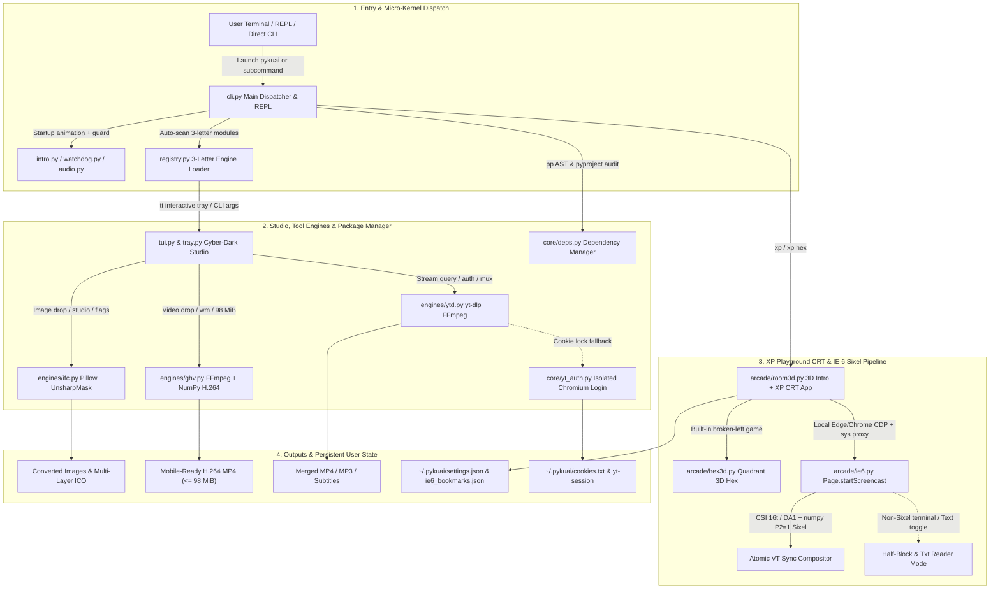

English | [简体中文](README.zh-CN.md)

# 🐍 PyKuai (v1.2.9) — Open-Source CS & Developer Script Toolbox

> **An open-source, modular CLI & TUI script toolbox built for Computer Science workflows, developer utilities, and community sharing.**  
> *"The Lord is my shepherd."* — Author: **TuKuai** ([GallantTarry](https://github.com/GallantTarry))

---

## 🌟 Overview & Design Philosophy

**PyKuai** *(from Chinese "Kuai", meaning fast)* is an open-source **micro-kernel + drop-in 3-letter plugin toolbox** built for Computer Science students, engineers, and Python developers. Rather than leaving handy automation scripts buried in scattered local folders, PyKuai gives them a unified terminal runtime so anyone can install and use them out of the box—or drop in standard three-letter `.py` engines to share with the community:

* **Zero-Config Micro-Kernel**: Drop any compliant three-letter lowercase `.py` module (`^[a-z]{3}$`) implementing [`BaseEngine`](https://github.com/GallantTarry/pykuai/blob/main/pykuai/core/base.py) into `pykuai/engines/`. PyKuai automatically discovers it and wires it into the Tool Tray (`tt`), CLI subcommand router, and dependency scanner (`pp`) with zero boilerplate.
* **Two-Tier Command Ergonomics**:
  * **Doubled 2-letter global commands** (`tt`, `bb`, `pp`, `xp`, `cc`) plus `help` / `gg` deliver instant muscle-memory navigation across the REPL console.
  * **3-letter tool engines** (`ifc`, `ghv`, `ytd`, ...) keep every utility isolated behind clean, collision-free namespaces.
* **Dual-Mode Execution & In-App Guides**: Run every engine either interactively through mouse-clickable **Rich / Textual** Cyber-Dark Studios (press `?` or `F1`, or click `?` in the top-right corner, for a full in-app feature guide) or headlessly via direct CLI flags in automation scripts.
* **Virtual CRT XP Playground (`xp`)**: Launches a 3D bedroom-to-PC cutscene into a simulated Windows XP Bliss desktop with `HEX 3D` and a Chromium/Edge CDP-backed **IE 6 Real Browser** supporting live **Sixel HD** true-pixel terminal projection.
* **Cyber-Dark Tactile Experience**: Features an ASCII banner, an optional high-DPI desktop pixel-snake launch sequence (`--fast` to skip), Windows Terminal title/icon protection, drag-and-drop image routing, and toggleable retro CC0 arcade sound effects persisted in `~/.pykuai/settings.json`.

---

## 🔄 Architecture & Data Flow



---

## ⚙️ End-to-End Flow & Core Technologies

| Stage | Data Flow | Core Technologies | What It Does |
| :--- | :--- | :--- | :--- |
| **1. CLI & REPL Runtime** | Terminal input → [`cli.py`](https://github.com/GallantTarry/pykuai/blob/main/pykuai/cli.py) → [`registry.py`](https://github.com/GallantTarry/pykuai/blob/main/pykuai/core/registry.py) / [`tray.py`](https://github.com/GallantTarry/pykuai/blob/main/pykuai/core/tray.py) | `Win32 ReadConsoleInputW`, `SGR Mouse`, `Rich`, regex `^[a-z]{3}$` reflection | Renders the startup pixel-snake intro and ASCII banner, intercepts raw keyboard/mouse/paste events with retro WAV SFX, and routes 2-letter global commands or 3-letter engines dynamically. |
| **2. Tool Engines & Toolchain** | [`tray.py`](https://github.com/GallantTarry/pykuai/blob/main/pykuai/core/tray.py) / CLI → [`ifc.py`](https://github.com/GallantTarry/pykuai/blob/main/pykuai/engines/ifc.py) / [`ghv.py`](https://github.com/GallantTarry/pykuai/blob/main/pykuai/engines/ghv.py) / [`ytd.py`](https://github.com/GallantTarry/pykuai/blob/main/pykuai/engines/ytd.py) / [`deps.py`](https://github.com/GallantTarry/pykuai/blob/main/pykuai/core/deps.py) | `Pillow`, `UnsharpMask`, `NumPy`, `yt-dlp`, `FFmpeg`, SHA256 verification, isolated Chromium cookies | Converts images and packs multi-layer `.ico` atomically, transcodes & cleans corner/edge watermarks into universal `<= 98 MiB` H.264 MP4s with `-14 LUFS` audio verification, downloads/muxes media via isolated Chromium session cookies, and resolves/installs FFmpeg and dependencies. |
| **3. XP CRT & Virtual Desktop** | [`launcher.py`](https://github.com/GallantTarry/pykuai/blob/main/pykuai/arcade/launcher.py) → [`room3d.py`](https://github.com/GallantTarry/pykuai/blob/main/pykuai/arcade/room3d.py) → [`hex3d.py`](https://github.com/GallantTarry/pykuai/blob/main/pykuai/arcade/hex3d.py) | `Textual`, 2x2 Quadrant Sub-Pixel Canvas, Synthesized E-flat Startup Chime | Plays a 3D bedroom-to-monitor cutscene, boots an interactive Windows XP `Bliss` desktop with Start/Off menu, and runs `HEX 3D` and IE 6 inside the terminal frame. |
| **4. Native IE 6 & Sixel HD Projection** | [`room3d.py`](https://github.com/GallantTarry/pykuai/blob/main/pykuai/arcade/room3d.py) ↔ [`ie6.py`](https://github.com/GallantTarry/pykuai/blob/main/pykuai/arcade/ie6.py) ↔ Local Edge/Chrome ↔ Terminal | `CDP WebSocket` (`Page.startScreencast`), `CSI 16t` / `DA1`, `numpy` `P2=1` Sixel, `\x1b[?2026h` Sync Output, `DECSCUSR` | Streams live viewport frames asynchronously, suppresses idle caret-blink redraws, atomically composites Sixel + UI without black flashes, and anchors the thin-bar IME cursor on clicked webpage coordinates. |

---

## 📁 Repository Architecture

```text
pykuai/
├── .github/
│   └── workflows/
│       └── publish.yml         # GitHub Actions Trusted Publishing workflow for PyPI
├── pyproject.toml              # Package metadata, core deps (incl. numpy), extras & CLI entrypoint
├── README.md                   # English documentation (GitHub homepage & PyPI)
├── README.zh-CN.md             # Chinese documentation (简体中文同步文档)
├── .gitignore                  # Git ignore rules (caches, builds, heavy binaries & temp outputs)
├── .backup_engines/            # Historical archive of 10 pre-refactor scripts (not loaded at runtime)
└── pykuai/                     # Core Python package
    ├── __init__.py             # Version (1.2.9) & author metadata
    ├── __main__.py             # python -m pykuai module entrypoint
    ├── cli.py                  # Main dispatcher (interactive REPL & direct CLI modes)
    ├── bench/                  # Build Bench (bb): same-window C editor, Clang & Windows x64 toolchain
    │   ├── __init__.py         # bb command dispatcher (interactive shell or headless compile)
    │   ├── toolchain.py        # Pinned LLVM-MinGW x64 download, SHA256 verify, probe & offline cache
    │   ├── shell.py            # Native PowerShell C workbench (bb <dir> ❯, edit, gg)
    │   ├── editor.py           # Textual UTF-8 C editor (Ctrl+S atomic save, Esc return, F1 help)
    │   └── edit_entry.py       # Child CLI entrypoint invoked by `edit <file.c>` inside bb
    ├── arcade/                 # XP Playground 3D CRT, mini-games & IE 6 real browser
    │   ├── __init__.py         # ArcadeGame plugin registry (~/.pykuai/settings.json scores)
    │   ├── launcher.py         # xp entry launcher & game summary table printer
    │   ├── hex3d.py            # hex: Built-in multicolored 3D Hex & Spotted Snake mini-game
    │   ├── room3d.py           # 3D cutscene, XP Bliss desktop, atomic VT Sixel compositor & IME anchor
    │   └── ie6.py              # Native IE 6 engine (Edge/Chrome CDP screencast, Sixel P2=1 & HB fallback)
    ├── core/                   # Micro-kernel infrastructure
    │   ├── __init__.py         # Core package marker
    │   ├── audio.py            # Non-blocking CC0 retro SFX player & persistent settings
    │   ├── base.py             # Abstract BaseEngine plugin contract
    │   ├── deps.py             # Dependency scanner & visual/CLI installer (pp)
    │   ├── intro.py            # High-DPI pixel-snake desktop launch intro (snake.wav)
    │   ├── registry.py         # Auto-discovery registry for 3-letter engine modules
    │   ├── tools.py            # Binary toolchain resolver & verified Windows FFmpeg installer
    │   ├── tray.py             # Interactive Tool Tray & subcommand dispatcher (tt)
    │   ├── tui.py              # Textual Cyber-Dark widgets, help modal (?/F1) & SFX hooks
    │   ├── ui.py               # Rich Cyber-Dark theme, ASCII banner, greeting & console hooks
    │   ├── watchdog.py         # Windows Terminal settings.json guard & exit cleanup
    │   └── yt_auth.py          # Isolated Chromium YouTube sign-in helper -> ~/.pykuai/cookies.txt
    ├── engines/                # Plug-and-play 3-letter tool engines
    │   ├── __init__.py         # Engines package marker
    │   ├── ifc.py              # ifc: Image Format Converter & multi-resolution ICO packer
    │   ├── ghv.py              # ghv: GitHub Video optimizer for local clips
    │   └── ytd.py              # ytd: YouTube & media downloader (yt-dlp + FFmpeg)
    ├── assets/                 # Visual & audio assets
    │   ├── icon.ico            # High-DPI multi-resolution application icon
    │   └── sfx/                # Retro CC0 sound effects
    │       ├── click.wav       # Button click SFX
    │       ├── enter.wav       # Command / dialog submit SFX
    │       ├── key.wav         # Keyboard typing & backspace SFX
    │       ├── paste.wav       # Clipboard paste & file drop SFX
    │       ├── snake.wav       # Launch pixel-snake hiss SFX
    │       └── type.wav        # Pixel-telegraph greeting SFX
    └── tools/                  # Lightweight portable Windows binaries & pixel font
        ├── yt-dlp.exe          # Standalone stream extractor binary (2026.10.26)
        ├── UnRAR.exe           # RAR extraction utility (7.30 beta 2)
        └── zpix.ttf            # Recommended pixel-style terminal font
                                # (ffmpeg/ffprobe resolved from PATH or auto-installed to ~/.pykuai/tools/)
```

### Module Breakdown

1. **Root Configuration, CI & Archive**
   * **[pyproject.toml](https://github.com/GallantTarry/pykuai/blob/main/pyproject.toml)**: Defines package metadata (`1.2.9`, Python `>=3.9`), core dependencies (`rich`, `textual`, `openpyxl`, `Pillow`, `pypdf`, `numpy`), optional extras (`office`, `media`, `cv`, `archive`, `ui`, `all`), package data (`tools/*`, `assets/*`, `assets/sfx/*`), and the `pykuai` console entrypoint.
   * **[.github/workflows/publish.yml](https://github.com/GallantTarry/pykuai/blob/main/.github/workflows/publish.yml)**: Passwordless PyPI Trusted Publishing pipeline (OIDC) triggered on `v*` / `pykuaiv*` tags or manual `workflow_dispatch`.
   * **[.backup_engines/](https://github.com/GallantTarry/pykuai/tree/main/.backup_engines)**: Reference archive of 10 pre-refactor standalone scripts (`archive.py`, `excel_merge.py`, `excel_split.py`, `img_compress.py`, `media_fetch.py`, `office_fixed.py`, `pdf_split.py`, `scanner.py`, `video_compress.py`, `web_sniffer.py`). Never loaded by `registry.py`.

2. **Micro-Kernel (`pykuai/core/`)**
   * **[cli.py](https://github.com/GallantTarry/pykuai/blob/main/pykuai/cli.py)** & **[tray.py](https://github.com/GallantTarry/pykuai/blob/main/pykuai/core/tray.py)**: Routes bare `pykuai` launches into the interactive REPL (with live keystroke, cursor, history, clipboard paste burst SFX, and automatic drag-and-drop image launch for `ifc`), or routes `pykuai tt <tool> [args]` directly to the target engine. `tt` includes a `?`/`F1` guide modal and bottom-right `🔊 SFX ON / 🔇 SFX OFF` toggle.
   * **[base.py](https://github.com/GallantTarry/pykuai/blob/main/pykuai/core/base.py)** & **[registry.py](https://github.com/GallantTarry/pykuai/blob/main/pykuai/core/registry.py)**: Defines the `BaseEngine` interface (including `help_text` and `launch_with_path`) and automatically registers valid 3-letter `.py` plugins under `pykuai/engines/`.
   * **[tui.py](https://github.com/GallantTarry/pykuai/blob/main/pykuai/core/tui.py)**, **[ui.py](https://github.com/GallantTarry/pykuai/blob/main/pykuai/core/ui.py)** & **[audio.py](https://github.com/GallantTarry/pykuai/blob/main/pykuai/core/audio.py)**: Provides the Cyber-Dark Rich theme, pixel-telegraph greeting, reusable Textual widgets (`PyKuaiStudioApp`, `StudioHeader`, `HelpChip`, `HelpModalScreen`, `ToggleChip`, `ActionChip`, `SfxToggleChip`, `pick_multi`, `pick_one`), non-blocking CC0 WAV SFX playback, and persistent `~/.pykuai/settings.json`.
   * **[deps.py](https://github.com/GallantTarry/pykuai/blob/main/pykuai/core/deps.py)**: Powers `pp`, auditing declared engine `requires` and AST imports against the active Python environment with clickable selection or CLI `--check` / `-y` / `--all` / `-U` modes.
   * **[tools.py](https://github.com/GallantTarry/pykuai/blob/main/pykuai/core/tools.py)** & **[yt_auth.py](https://github.com/GallantTarry/pykuai/blob/main/pykuai/core/yt_auth.py)**: Resolves external tools (`ffmpeg`, `ffprobe`, `yt-dlp`, `UnRAR`, Node/Deno JS runtimes) across bundled `tools/`, system `PATH`, and `~/.pykuai/tools/`, downloads & SHA256-verifies Windows `FFmpeg`/`FFprobe` essentials on demand (`urllib` + `curl`/direct fallback), and drives the extension-free isolated browser YouTube login flow (`~/.pykuai/yt-session` → `~/.pykuai/cookies.txt`).
   * **[intro.py](https://github.com/GallantTarry/pykuai/blob/main/pykuai/core/intro.py)** & **[watchdog.py](https://github.com/GallantTarry/pykuai/blob/main/pykuai/core/watchdog.py)**: Plays the high-DPI desktop pixel-snake launch animation (`snake.wav`) and safely restores Windows Terminal title/icon state on exit.

3. **XP Playground CRT & Real Browser (`pykuai/arcade/`)**
   * **[launcher.py](https://github.com/GallantTarry/pykuai/blob/main/pykuai/arcade/launcher.py)** & **[hex3d.py](https://github.com/GallantTarry/pykuai/blob/main/pykuai/arcade/hex3d.py)**: Launches the `xp` experience (`xp`, `xp hex`, `xp help`) and renders the built-in `HEX 3D` game (`hex`) on a 2x2 sub-pixel canvas.
   * **[room3d.py](https://github.com/GallantTarry/pykuai/blob/main/pykuai/arcade/room3d.py)** & **[ie6.py](https://github.com/GallantTarry/pykuai/blob/main/pykuai/arcade/ie6.py)**: Renders the 3D cutscene and Windows XP Bliss desktop, runs local Edge/Chrome over CDP (`Page.startScreencast`) with system proxy inheritance and streamlined native IE 6 chrome, projects real-time **Sixel HD** (`P2=1`, `numpy` quantized palette) or TrueColor Half-Block frames inside the CRT, eliminates focus-blur black flashes with atomic `\x1b[?2026h...\x1b[?2026l` compositing, and anchors the visible thin-bar cursor onto clicked webpage coordinates for accurate IME input.

4. **Built-In Engines (`pykuai/engines/`) & Build Bench (`pykuai/bench/`)**
   * **[pykuai/bench/](https://github.com/GallantTarry/pykuai/tree/main/pykuai/bench)** (`bb` — *Build Bench*): Same-window Windows x64 C programming workbench (`bb <dir> ❯`, `edit`, `clang`, `.\app.exe`, `gg`) backed by an auto-provisioned, SHA256-verified LLVM-MinGW toolchain cached under `~/.pykuai/tools/bb/`.
   * **[ifc.py](https://github.com/GallantTarry/pykuai/blob/main/pykuai/engines/ifc.py)** (`ifc` — *Image Format Converter*)
   * **[ghv.py](https://github.com/GallantTarry/pykuai/blob/main/pykuai/engines/ghv.py)** (`ghv` — *GitHub Video*)
   * **[ytd.py](https://github.com/GallantTarry/pykuai/blob/main/pykuai/engines/ytd.py)** (`ytd` — *YouTube Download*)

---

## 🧰 Built-In Engines & Key Features

### 1. `ifc` — Image Format Converter
* **Formats**: Exports to `ICO`, `PNG`, `JPG`, `WEBP`, `BMP`, `GIF`, `TIFF`, and `AVIF`; reads broader sources including `JPEG`, `TIF`, `ICNS`, `TGA`, `PPM`, `DDS`, and `PSD`.
* **Smart Image Pipeline**: Automatically normalizes EXIF orientation, extracts the highest-resolution layer from `ICO`/`ICNS` or first frame of animated images, flattens transparent pixels onto solid white when targeting `JPG`/`BMP`, and performs atomic temp-file writes to prevent half-written files or accidental self-overwrite.
* **Multi-Resolution `.ico` Packaging**: Toggle any combination of sizes from `8` to `256` px (`Std`, `All`, `Web` presets), pads non-square images cleanly onto a transparent square canvas, and applies subtle `UnsharpMask` sharpening on tiny layers (`<= 32px`, toggleable or `--no-sharpen`).
* **Lossy Quality Control**: Studio chips (`80%` / `90%` / `92%` / `95%` / `100%`) or CLI `-q 1..100` (default `92`) for `JPG`, `WEBP`, and `AVIF`.

### 2. `ytd` — YouTube & Media Downloader
* **Profiles & Aliases**: `best` (Auto-muxed MP4), `1080p`, `720p`, `mp3` (`--audio-quality 0`), and `m4a` (CLI aliases: `video`/`mp4` → `best`, `audio` → `mp3`).
* **Scope, Subtitles & Probing**: Switch cleanly between `Single` (`--no-playlist`, even with `&list=`) and `Playlist` (`--yes-playlist`), download & embed English/Chinese captions (`--subs`), or inspect all available streams without downloading (`-F` / `Formats`).
* **Extension-Free `Login YouTube` (`--login`)**: Windows Chrome/Edge (`127+`) locks its cookie DB (`yt-dlp #7271`) and enforces App-Bound Encryption (`#10927`). Click **`Login YouTube`** in Studio (or run `pykuai tt ytd --login`) to sign in inside an isolated browser profile (`~/.pykuai/yt-session`)—PyKuai captures the authenticated session automatically into `~/.pykuai/cookies.txt` without touching your personal browser or needing third-party extensions. Interactive downloads hitting YouTube's sign-in gate also offer to open this login flow and retry immediately.
* **Smart Resilience & On-Demand FFmpeg**: Automatically wires `ejs:github` challenge solving when Node/Deno is installed, prefers bundled `yt-dlp.exe` when Python `yt-dlp` lacks `curl_cffi`, auto-detects `cookies.txt` across save/working dirs, `~/.pykuai/cookies.txt`, and `~/Downloads`, and prompts to install SHA256-verified Windows FFmpeg/FFprobe binaries into `~/.pykuai/tools/` (`--install-ffmpeg`) whenever missing.

### 3. `ghv` — GitHub Video & Mobile Universal Optimizer

Drop any local video directly into the PyKuai REPL prompt and press Enter to process with defaults, or launch `ghv` inside Tool Tray (`tt`) / CLI to customize options. Outputs are written atomically beside the source as `<name>_mobile.mp4`.

#### Golden Encoding & Compatibility Specification

| Core Metric | Target Configuration | Why It Matters |
| :--- | :--- | :--- |
| **Video Codec** | **H.264 / AVC (`avc1`)** | 99.99% global compatibility with native hardware decoding on every mobile & desktop GPU. |
| **Profile** | **High Profile (`-8x8dct 1`)** | Sharper detail and higher compression efficiency than Baseline without color banding. |
| **Level** | **Level 3.1** | Strictly enforces ITU-T H.264 Table A-1 limits (`<= 3,600` MB/frame, `<= 108,000` MB/s, `<= 17.5 Mbps`, DPB `<= 18,000` MB) for low-heat playback even on 10-year-old chips. |
| **Pixel Format** | **8-bit `yuv420p` (BT.709)** | Strictly avoids unplayable 10-bit / 4:2:2 / 4:4:4 streams; HDR (`PQ`/`HLG`) inputs are tone-mapped (Hable) to 8-bit SDR BT.709 with full color tags (`primaries/trc/matrix/tv`). |
| **Audio Codec & Loudness** | **AAC-LC 48 kHz Stereo (`mp4a`) · `-14 LUFS`** | Universal HTML5 `<video>` audio with default two-pass EBU R128 loudness normalization (`-14 LUFS`, `-1.5 dBTP` true-peak protection) and strict post-encode AAC verification (silent clips remain silent). |
| **Streaming Flag** | **`+faststart` (`moov` atom first)** | Relocates the MP4 `moov` index ahead of `mdat` (verified via binary atom walk) for instant mobile seek & progressive playback. |
| **Resolution Strategy** | **Adaptive 720p (Long Side `<= 1280`, Short Side `<= 720`)** | Landscape `16:9` → `1280×720`, Portrait `9:16` → `720×1280` (same 3,600 macroblocks, Level 3.1 compliant), `4:3` → `960×720` with `SAR 1:1`; preserves display aspect ratio cleanly, never stretches 4:3, never upscales smaller sources. |
| **File Size Cap** | **`<= 98 MiB` (Binary, `102,760,448 B`)** | Default `98 MiB` hard ceiling (selectable `98 / 50 / 25 MiB` in Studio or `--max-mb 1..98`) guaranteed via capped CRF, 2-pass ABR, and automatic geometry/bitrate retry. |

#### Video Processing Pipeline & Capabilities

* **1. Stream Probing & Display Normalization**: Reads rotation metadata (`side_data` / `rotate`) and non-square `SAR` via `ffprobe`, normalizing display geometry and capping cadence cleanly (`60 → 30 fps`, `50 → 25 fps`) whenever required by H.264 Level 3.1.
* **2. Precision Corner/Edge Watermark Detection & Removal (`--wm auto`)**:
  * **Fast Adaptive Sampling**: Uses a single streaming FFmpeg gray pipe for clips `<= 45s` and bounded parallel seeks for long videos, analyzing overlapping sliding windows to catch both permanent and corner-switching logos (e.g., TikTok/Douyin-style jumps).
  * **Solid Opaque + Translucent Coverage**: Detects both opaque solid corner badges (frozen interior backed by moving surrounding ring) and translucent overlays (capped adaptive gradient threshold + anisotropic dilation + proximity box merging to prevent fragmentation or time-axis flicker), while strictly shielding central video subjects from false positives.
  * **Manual Precision & Preview**: Removes regions via FFmpeg `delogo`, supports `--analyze` (dry-run report), `--show-wm` (green preview boxes), and repeatable `--wm-box X:Y:W:H` overrides in displayed source pixels (auto-mapped across non-1:1 SAR).
* **3. Loudness Normalization & Strict Verification**: Runs two-pass EBU R128 `loudnorm` (`-14 LUFS` default, `-16 LUFS` or `--no-loudnorm` optional) followed by decoded AAC verification and look-ahead transient limiting / audio-only remux correction if peaks exceed `-1.5 dBTP`.
* **4. Budget-Driven Encoding & Atomic Publication**: Uses capped CRF (`-crf 14`) on short clips and 2-pass ABR on tighter budgets; if an encode still exceeds the target MiB limit, automatically retries by lowering bitrate and stepping down resolution/fps/audio bitrate before atomically committing via `os.replace`.
* **5. Mandatory Post-Encode Verification**: Every finished MP4 must pass automated `ffprobe` + binary MP4 atom checks (`avc1`, `High`, `Level 3.1`, `yuv420p`, `SAR 1:1`, Level 3.1 cadence, `AAC-LC mp4a 48 kHz stereo`, `moov` before `mdat`, and `<= 98 MiB`) before replacing the destination file.

---

## 🚀 Usage & Global Commands

### 1. Interactive Console Mode (REPL)

Launch the workbench from any terminal:

```bash
pykuai
# Skip the pixel-snake launch intro (also supports --no-intro or -f):
pykuai --fast
```

Inside the console, use the core commands (`help` prints the table, `gg` quits, and the banner's right-side `🔊 SFX ON / 🔇 SFX OFF` pill toggles global audio on click):

| Command | Meaning | Description |
| :--- | :--- | :--- |
| `tt` | **Tool Tray** | Open the interactive Tool Tray, or run `tt <tool> [args]` |
| `pp` | **Pull Packages** | Audit and install/upgrade plugin dependencies (`pp --check` / `pp -y` / `pp -U`) |
| `bb` | **Build Bench** | Same-window C editor, compiler and shell for Windows 10/11 x64. Enter `gg` to return. |
| `xp` | **XP Playground** | Launch the 3D cutscene & virtual Windows XP CRT (`HEX 3D` & `IE 6` browser) |
| `cc` | **Clear Console** | Clear the screen and redraw the Cyber-Dark banner |

> 💡 **Pro Tip**: Dragging or pasting an image or video file path straight into the REPL prompt automatically opens `ifc` (images) or `ghv` (videos) pre-loaded with that file.

### 2. Direct CLI Mode

Start a C session in the current directory with `pykuai bb`. On first use it downloads and verifies the complete pinned LLVM-MinGW toolchain in your user cache. Later sessions can compile offline. Type `edit hello.c`, save with Ctrl+S, and press Esc to return. Run `clang hello.c -o hello.exe`, then `.\hello.exe`. To compile an existing file directly, use `pykuai bb hello.c`.

Run tools headlessly or script them in pipelines without entering the REPL:

```bash
# Open interactive Tool Tray (prints a summary table when piped/non-TTY)
pykuai tt

# Image format conversion & multi-layer .ico generation (ifc)
pykuai tt ifc logo.png -t webp -q 90
pykuai tt ifc logo.png -t ico -s 16,32,48,256 -o app.ico

# Optimize a local video (H.264 High@L3.1, <= 98 MiB, -14 LUFS, auto corner watermark removal)
pykuai tt ghv "my clip.mov"
pykuai tt ghv "my clip.mov" --max-mb 50 --lufs -16 -o preview.mp4
pykuai tt ghv "my clip.mov" --analyze
pykuai tt ghv "my clip.mov" --show-wm
pykuai tt ghv "my clip.mov" --wm-box 20:20:260:90

# YouTube & media download, stream probing, login & FFmpeg setup (ytd)
pykuai tt ytd "https://www.youtube.com/watch?v=..." -f best
pykuai tt ytd "https://www.youtube.com/watch?v=..." -f mp3 --subs -o ./music
pykuai tt ytd "https://www.youtube.com/watch?v=..." -F
pykuai tt ytd --login
pykuai tt ytd --install-ffmpeg

# Audit, install, or upgrade dependencies (pp)
pykuai pp --check
pykuai pp -y
pykuai pp -y --all -U

# Help & version
pykuai help
pykuai xp
pykuai --version
```

> **Note on External Binaries**: Git and PyPI distributions stay lightweight by bundling `yt-dlp.exe`, `UnRAR.exe`, and `zpix.ttf` without heavy FFmpeg binaries. On Windows, if `ffmpeg` / `ffprobe` are not already on `PATH` or in `~/.pykuai/tools/`, `ytd` automatically prompts to download and SHA256-verify official FFmpeg essentials into `~/.pykuai/tools/` (or run `pykuai tt ytd --install-ffmpeg`).

---

## 🧩 Extending PyKuai (3-Letter Plugin Contract)

Create a `.py` file named with **three lowercase letters** (e.g. `pykuai/engines/pdf.py`) subclassing [`BaseEngine`](https://github.com/GallantTarry/pykuai/blob/main/pykuai/core/base.py):

```python
# -*- coding: utf-8 -*-
import argparse
from rich.console import Console
from pykuai.core.base import BaseEngine


class MyToolEngine(BaseEngine):
    name = "pdf"
    description = "Merge or split PDF documents"
    usage = "tt pdf | tt pdf <files> [-o output]"
    category = "Document"
    requires = ["pypdf>=3.0.0"]
    help_text = "Click Merge or Split in interactive mode, or pass PDF files via CLI."

    def register_args(self, parser: argparse.ArgumentParser) -> None:
        parser.add_argument("files", nargs="*", help="Input PDF file paths")
        parser.add_argument("-o", "--output", default="merged.pdf", help="Output file path")

    def run_direct(self, args: argparse.Namespace, console: Console) -> int:
        if not args.files:
            return self.run_interactive(console)
        console.print(f"[#00FF00]Processing {len(args.files)} file(s)...[/#00FF00]")
        return 0

    def run_interactive(self, console: Console) -> int:
        from pykuai.core.tui import pick_one
        mode = pick_one("Select PDF Action", [("Merge PDFs", "merge"), ("Split PDF", "split")])
        if mode:
            console.print(f"[#00FF00]Selected mode: {mode}[/#00FF00]")
        return 0
```

Restart `pykuai`—no core edits or manual registration needed. `pdf` appears immediately in `tt`, and `pp` automatically tracks its `requires` packages and imports.

---

## ✨ What's New in v1.2.9

* **Build Bench (`bb`) — Same-Window C Workbench for Windows x64 ([`pykuai/bench/`](https://github.com/GallantTarry/pykuai/tree/main/pykuai/bench))**: Type `bb` from the PyKuai prompt (or `pykuai bb` / `pykuai bb hello.c [-o app.exe]`) to switch the current terminal into a green `bb <dir> ❯` C programming workbench. Features an in-window UTF-8 Textual editor (`edit hello.c`, `Ctrl+S` atomic save, `Esc` return with unsaved guard, `F1` / `?` help modal), real `clang` compilation and interactive `scanf` execution (`gg` inside a running C program goes straight to the program; `gg` at `bb ❯` returns to `pykuai ❯`).
* **Zero-Visual-Studio Pinned LLVM-MinGW Provisioning**: On first entry to `bb`, PyKuai automatically downloads pinned `llvm-mingw-20261117-ucrt-x86_64.zip` with live progress, verifies exact byte length + SHA256 digest + zip entry safety, compiles and runs a real C `stdio.h` self-test, and atomically publishes it into `~/.pykuai/tools/bb/` for instant offline compilation afterwards.
* **GitHub Video (`ghv`) Precision Upgrade**: Standardized binary `<= 98 MiB` cap (`98 / 50 / 25 MiB` chips, `--max-mb 1..98`), orientation-aware adaptive 720p (`<= 1280×720` landscape / `<= 720×1280` portrait / never stretching 4:3), complete BT.709 color tags, strict `-14 LUFS` verification, and upgraded corner/edge watermark detection covering solid opaque badges, translucent overlays, and corner-switching logos with SAR-aware `--wm-box` mapping.

---

## ✨ What's New in v1.2.8

* **XP Playground (`xp`)**: Redesigned the arcade experience as `xp`, featuring a 3D bedroom-to-PC intro leading into a minimalist Windows XP Bliss desktop with `HEX 3D`, a focused `START` -> `OFF` shutdown menu, incremental desktop refreshes, and one-click app launch.
* **Built-In Native IE 6 Real Browser ([`ie6.py`](https://github.com/GallantTarry/pykuai/blob/main/pykuai/arcade/ie6.py))**: Added an embedded Chromium/Edge CDP browser inside the XP CRT (`Page.startScreencast`), supporting direct URL & domain navigation (never hijacking addresses to third-party portals), automatic local system proxy inheritance, user bookmarks (`~/.pykuai/ie6_bookmarks.json`), and seamless `View` / `Txt` reading-mode toggling.
* **True-Pixel Sixel HD Projection & Fast `numpy` Pipeline**: Added terminal cell detection (`CSI 16t` / `DA1`) and off-main-thread `numpy`-vectorized `128`-color Sixel (`P2=1`) streaming inside supported terminals (e.g., Windows Terminal) with automatic 24-bit TrueColor Half-Block (`▀`) fallback—and promoted `numpy>=1.24.0` to core dependencies in `pyproject.toml`.
* **Zero-Flash Compositing, Native IME Anchoring & Streamlined Chrome**: Synced Textual UI + Sixel frames atomically via `\x1b[?2026h ... \x1b[?2026l`, stripped focus-blur interior overwrites and idle caret-blink jitter, anchored the terminal cursor onto clicked webpage coordinates so Chinese/OS IME popups follow webpage inputs cleanly instead of sticking behind `Addr` or drifting outside PowerShell, removed redundant view-control buttons, and auto-hid empty bookmark bars.
* **Home Banner & Global `SFX` Polish**: Placed author/version details alongside the `PYKUAI` banner, added a mouse-clickable `🔊 SFX ON / 🔇 SFX OFF` sound toggle, simplified REPL navigation to `xp`, `help`, and `gg`, and eliminated unwanted blue click-selection stripes.

---

## ✨ What's New in v1.2.7

* **Built-In `Login YouTube` (`--login`)**: Added [`yt_auth.py`](https://github.com/GallantTarry/pykuai/blob/main/pykuai/core/yt_auth.py) and `Login YouTube` in `YtdStudioApp`, enabling zero-extension sign-in via an isolated Chromium profile (`~/.pykuai/yt-session`) that saves `~/.pykuai/cookies.txt` and retries YouTube bot-check blocks interactively.
* **Lean Distribution & Auto FFmpeg Installer (`--install-ffmpeg`)**: Removed ~200 MiB `ffmpeg.exe` / `ffprobe.exe` binaries from Git/PyPI packages while adding SHA256-verified on-demand installation into `~/.pykuai/tools/` with proxy/curl fallbacks.
* **Universal Studio Feature Guides (`?` / `F1`)**: Added clickable top-right `?` help buttons and `HelpModalScreen` documentation dialogs across `tt`, `pp`, `ifc`, and `ytd`.
* **Reliability & Toolchain Upgrades**: Updated bundled `yt-dlp.exe` (`2026.10.26`) and `UnRAR.exe` (`7.30 beta 2`), preferred bundled `yt-dlp.exe` when Python `yt-dlp` lacks `curl_cffi`, improved responsive narrow-terminal Studio layouts and URL/path sanitization, and added Windows Chromium lock fallback.

---

## 🙏 Open-Source Credits & Assets

* **[yt-dlp](https://github.com/yt-dlp/yt-dlp)** — Stream extraction engine powering `pykuai tt ytd`
* **[FFmpeg](https://ffmpeg.org/)** — Media muxing and MP3/M4A audio transcoding
* **[Pillow](https://python-pillow.org/)** — Multi-format image processing powering `pykuai tt ifc`
* **[Textual](https://textual.textualize.io/)** & **[Rich](https://github.com/Textualize/rich)** — Cyber-Dark interactive TUI widgets and console rendering
* **[Kenney Audio](https://kenney.nl/)** & **[CC0 Public Domain Sounds](https://github.com/lavenderdotpet/CC0-Public-Domain-Sounds)** — Retro CC0 UI click, key, enter, paste, telegraph, and pixel-snake sound effects

---

## License

Copyright © 2026 TuKuai (GallantTarry). Licensed under the [Apache License 2.0](LICENSE).

> Third-party notice: Bundled external tools and assets (`pykuai/tools/yt-dlp.exe`, `pykuai/tools/UnRAR.exe`, `pykuai/tools/zpix.ttf`, and CC0 sound effects under `pykuai/assets/sfx/`), declared Python dependencies in `pyproject.toml`, and runtime-downloaded tools (such as `FFmpeg`) remain subject to their respective original licenses.
