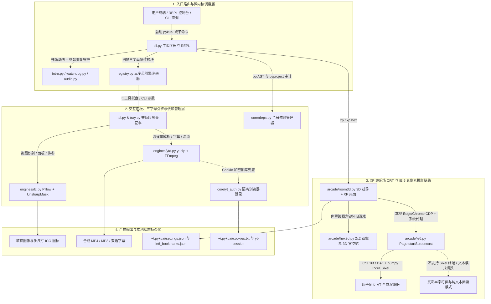

[English](README.md) | 简体中文

# 🐍 PyKuai (v1.2.8) — 面向计算机专业的开源脚本工具箱

> **开源、模块化的 Python CLI / TUI 脚本工具箱——让实用开发者脚本开箱即用、共享互通**  
> *"The Lord is my shepherd."* — Author: **TuKuai** ([GallantTarry](https://github.com/GallantTarry))

---

## 🌟 核心定位与设计哲学

**PyKuai**（取意自中文「快」）是一个面向**计算机专业学习者、工程师与开发者社区**的开源 **「微内核 + 即插即用三字母引擎」脚本工具箱**。与其让好用的自动化脚本各自散落在本地文件夹里无人知晓，不如通过统一约定把它们变成开箱即用、人人都能安装复用的终端工具集，同时也方便随时扩展和向社区分享新插件：

* **零配置微内核架构**：在 `pykuai/engines/` 中放入任意符合三位纯小写字母命名规范（`^[a-z]{3}$`）并继承 [`BaseEngine`](https://github.com/GallantTarry/pykuai/blob/main/pykuai/core/base.py) 的 `.py` 模块，PyKuai 即可零样板代码自动扫描识别，并自动接入工具托盘（`tt`）、CLI 子命令路由与依赖检测（`pp`）。
* **双层指令人体工学**：
  * **两位叠字全局指令**（`tt`、`pp`、`xp`、`cc`）配合 `help` / `gg`：形成极快的肌肉记忆终端导航。
  * **三位字母工具引擎**（`ifc`、`ytd` 等）：为每款工具提供清晰、互不冲突的独立命名空间。
* **交互与静默双模式并行 + 内置使用手册**：所有工具既可通过鼠标可点击的 **Rich / Textual** 赛博暗黑交互面板运行（按 `?` 或 `F1`，或点击右上角 `?` 即可弹出完整的英文功能详解弹窗），也可直接在 Shell 与自动化脚本中传参直调。
* **虚拟 CRT Windows XP 游乐场（`xp`）**：从 3D 卧室潜行开机过场直达虚拟 Windows XP Bliss 桌面，内置 `HEX 3D` 与基于本地 Edge/Chrome CDP 驱动的**原生 IE 6 真实浏览器**（支持终端内 **Sixel HD** 真像素实时投影）。
* **赛博触感与界面英语化**：自带 ASCII Banner、可选的高 DPI 桌面像素贪吃蛇开场动画（`--fast` 跳过）、Windows Terminal 标题与图标退出还原、图片拖入自动识别、以及可持久化开关的复古 CC0 街机音效（保存至 `~/.pykuai/settings.json`）；运行时界面与指令保持简洁英文，便于对接上游生态并面向全球社区分享。

---

## 🔄 全链路架构与数据流转图



---

## ⚙️ 分阶段流程与核心技术栈

| 阶段 | 数据流向（从哪到哪） | 采用的核心专业技术 | 具体完成的工作 |
| :--- | :--- | :--- | :--- |
| **1. 控制台与 REPL 调度** | 终端输入 → [`cli.py`](https://github.com/GallantTarry/pykuai/blob/main/pykuai/cli.py) → [`registry.py`](https://github.com/GallantTarry/pykuai/blob/main/pykuai/core/registry.py) / [`tray.py`](https://github.com/GallantTarry/pykuai/blob/main/pykuai/core/tray.py) | `Win32 ReadConsoleInputW`、`SGR Mouse`、`Rich`、`^[a-z]{3}$` 反射加载 | 绘制像素贪吃蛇开场与 Banner，捕获原始键鼠/粘贴突发事件并播放 CC0 WAV 音效，自动注册并分发全局双字母指令与三字母插件。 |
| **2. 工具引擎与依赖体系** | [`tray.py`](https://github.com/GallantTarry/pykuai/blob/main/pykuai/core/tray.py) / CLI → [`ifc.py`](https://github.com/GallantTarry/pykuai/blob/main/pykuai/engines/ifc.py) / [`ytd.py`](https://github.com/GallantTarry/pykuai/blob/main/pykuai/engines/ytd.py) / [`deps.py`](https://github.com/GallantTarry/pykuai/blob/main/pykuai/core/deps.py) | `Pillow`、`UnsharpMask`、`yt-dlp`、`FFmpeg`、SHA256 校验、隔离 Chromium Cookie 提取 | 原子化转换图像与打包多分辨率 `.ico`；支持免扩展登录 YouTube 解决 127+ 锁库加密并按需校验安装 FFmpeg；结合 AST 与 `pyproject.toml` 管理环境依赖。 |
| **3. XP CRT 与桌面引擎** | [`launcher.py`](https://github.com/GallantTarry/pykuai/blob/main/pykuai/arcade/launcher.py) → [`room3d.py`](https://github.com/GallantTarry/pykuai/blob/main/pykuai/arcade/room3d.py) → [`hex3d.py`](https://github.com/GallantTarry/pykuai/blob/main/pykuai/arcade/hex3d.py) | `Textual`、2x2 四象限亚像素画布、合成降 E 大调 XP 启动和弦 | 播放 3D 卧室开机过场，呈现含 `Bliss` 壁纸与精简 `START -> OFF` 菜单的 Windows XP 桌面，并在终端内原生运行 `HEX 3D` 与 IE 6。 |
| **4. 原生 IE 6 与 Sixel HD 投影** | [`room3d.py`](https://github.com/GallantTarry/pykuai/blob/main/pykuai/arcade/room3d.py) ↔ [`ie6.py`](https://github.com/GallantTarry/pykuai/blob/main/pykuai/arcade/ie6.py) ↔ 本地 Edge/Chrome ↔ 终端屏幕 | `CDP WebSocket`（`Page.startScreencast`）、`CSI 16t` / `DA1`、`numpy` `P2=1` Sixel、`\x1b[?2026h` 同步输出、`DECSCUSR` | 异步接收实时网页帧并过滤空闲光标闪烁与重复负载；通过原子同步输出消除焦点切换导致的黑屏闪烁，并将细竖线光标动态锚定在网页点击位置以修复中文输入法偏移问题。 |

---

## 📁 仓库结构与板块说明

```text
pykuai/
├── .github/
│   └── workflows/
│       └── publish.yml         # GitHub Actions Trusted Publishing 自动构建与发布 PyPI 流水线
├── pyproject.toml              # 包元信息、核心依赖（含 numpy）、可选分组与全局 pykuai 入口
├── README.md                   # 项目英文主文档（用于 GitHub 首页与 PyPI 展示）
├── README.zh-CN.md             # 项目简体中文同步文档（与英文文档保持同步）
├── .gitignore                  # Git 忽略规则（缓存、构建产物、大体积二进制与临时输出）
├── .backup_engines/            # 早期重构前保留的 10 个历史参考脚本（运行时不会加载）
└── pykuai/                     # 核心 Python 包目录
    ├── __init__.py             # 版本号（1.2.8）与作者元信息
    ├── __main__.py             # python -m pykuai 模块化启动入口
    ├── cli.py                  # 主控制台调度器（REPL 交互循环与 CLI 直达分支）
    ├── arcade/                 # XP Playground 3D CRT、怀旧游戏与内置 IE 6 真实浏览器
    │   ├── __init__.py         # ArcadeGame 游乐场小游戏插件注册表与最高分存储
    │   ├── launcher.py         # xp 入口启动器与游乐场摘要表格输出
    │   ├── hex3d.py            # hex: 内置 3D 多彩六边形与斑点蛇小游戏
    │   ├── room3d.py           # 3D 过场动画、XP Bliss 桌面、Sixel 原子合成渲染与 IME 光标锚定
    │   └── ie6.py              # 原生 IE 6 引擎（Edge/Chrome CDP 推流、Sixel P2=1 与半字符兜底）
    ├── core/                   # 微内核基础设施层
    │   ├── __init__.py         # core 包标识文件
    │   ├── audio.py            # 非阻塞 CC0 复古音效播放器与开关状态持久化
    │   ├── base.py             # 插件契约抽象基类 BaseEngine
    │   ├── deps.py             # 全局依赖检测与可视化/CLI 安装器（pp）
    │   ├── intro.py            # 高 DPI 桌面像素贪吃蛇开场过场动画（联动 snake.wav）
    │   ├── registry.py         # 三字母工具引擎自动扫描与注册器
    │   ├── tools.py            # 外部二进制工具定位器与 Windows FFmpeg 自动校验安装器
    │   ├── tray.py             # 可视化工具托盘与子命令统一分发器（tt）
    │   ├── tui.py              # Textual 赛博暗黑 UI 组件、帮助弹窗（?/F1）与音效钩子
    │   ├── ui.py               # Rich 暗黑主题配色、ASCII Banner、像素电报引导语与窗口保护
    │   ├── watchdog.py         # Windows Terminal settings.json 状态守护与异常退出恢复
    │   └── yt_auth.py          # 隔离浏览器一键登录 YouTube 并自动生成 ~/.pykuai/cookies.txt
    ├── engines/                # 即插即用三字母功能引擎层
    │   ├── __init__.py         # engines 包标识文件
    │   ├── ifc.py              # ifc: 图像格式转换与多分辨率 ICO 图标容器打包工具
    │   └── ytd.py              # ytd: YouTube 及主流平台音视频下载提取工具（yt-dlp + FFmpeg）
    ├── assets/                 # 视觉图标与音频静态资源
    │   ├── icon.ico            # 高 DPI 多尺寸应用图标
    │   └── sfx/                # 复古 CC0 音效资源目录
    │       ├── click.wav       # 鼠标点击按键音效
    │       ├── enter.wav       # 回车提交确认音效
    │       ├── key.wav         # 键盘打字与退格删除音效
    │       ├── paste.wav       # 剪贴板粘贴与文件拖入音效
    │       ├── snake.wav       # 开场像素蛇「嘶嘶」音效
    │       └── type.wav        # 开场像素电报打字引导音效
    └── tools/                  # 轻量级便携 Windows 命令行工具与像素字体
        ├── yt-dlp.exe          # 独立流媒体解析可执行文件（2026.10.26）
        ├── UnRAR.exe           # RAR 压缩包解压实用工具（7.30 beta 2）
        └── zpix.ttf            # 推荐搭配的像素风格终端字体
                                # （ffmpeg/ffprobe 优先读取系统 PATH 或按需自动安装至 ~/.pykuai/tools/）
```

### 各板块详细职责

1. **根目录配置、发布流水线与历史归档**
   * **[pyproject.toml](https://github.com/GallantTarry/pykuai/blob/main/pyproject.toml)**：定义项目名称、版本号（`1.2.8`）、Python 版本要求（`>=3.9`）、核心依赖（`rich`、`textual`、`openpyxl`、`Pillow`、`pypdf`、`numpy`）、可选分组（`office` / `media` / `cv` / `archive` / `ui` / `all`）、打包静态资源（`tools/*`、`assets/*`、`assets/sfx/*`）及全局命令行入口 `pykuai`。
   * **[.github/workflows/publish.yml](https://github.com/GallantTarry/pykuai/blob/main/.github/workflows/publish.yml)**：基于 GitHub OIDC 的无密钥 PyPI Trusted Publishing 自动构建与发布流水线，推送 `v*` / `pykuaiv*` 标签或手动触发 `workflow_dispatch` 即可发布。
   * **[.backup_engines/](https://github.com/GallantTarry/pykuai/tree/main/.backup_engines)**：存放重构前留存的 10 个独立参考脚本（`archive.py`、`excel_merge.py`、`excel_split.py`、`img_compress.py`、`media_fetch.py`、`office_fixed.py`、`pdf_split.py`、`scanner.py`、`video_compress.py`、`web_sniffer.py`），仅作归档参考，不会被 `registry.py` 自动加载。

2. **微内核层（`pykuai/core/`）**
   * **[cli.py](https://github.com/GallantTarry/pykuai/blob/main/pykuai/cli.py)** 与 **[tray.py](https://github.com/GallantTarry/pykuai/blob/main/pykuai/core/tray.py)**：无参数启动时进入 REPL 交互控制台（支持实时按键、光标移动、历史翻查、粘贴突发音效，以及拖入图片自动唤起 `ifc`）；带子参数时直达 `pykuai tt <tool> [args]` 执行。`tt` 面板内置 `?`/`F1` 帮助弹窗与右下角 `🔊 SFX ON / 🔇 SFX OFF` 全局音效开关。
   * **[base.py](https://github.com/GallantTarry/pykuai/blob/main/pykuai/core/base.py)** 与 **[registry.py](https://github.com/GallantTarry/pykuai/blob/main/pykuai/core/registry.py)**：定义 `BaseEngine` 插件规范（含 `help_text` 与 `launch_with_path` 扩展点），并在运行时自动注册 `pykuai/engines/` 下合法的三字母 `.py` 引擎。
   * **[tui.py](https://github.com/GallantTarry/pykuai/blob/main/pykuai/core/tui.py)**、**[ui.py](https://github.com/GallantTarry/pykuai/blob/main/pykuai/core/ui.py)** 与 **[audio.py](https://github.com/GallantTarry/pykuai/blob/main/pykuai/core/audio.py)**：提供 Cyber-Dark Rich 视觉主题、像素电报打字引导、可复用 Textual 控件（`PyKuaiStudioApp`、`StudioHeader`、`HelpChip`、`HelpModalScreen`、`ToggleChip`、`ActionChip`、`SfxToggleChip`、`pick_multi`、`pick_one`）、非阻塞 WAV 音效播放以及 `~/.pykuai/settings.json` 状态持久化。
   * **[deps.py](https://github.com/GallantTarry/pykuai/blob/main/pykuai/core/deps.py)**：驱动 `pp` 指令，结合 `pyproject.toml`、引擎声明的 `requires` 以及 AST 导入扫描检测环境缺失依赖，支持可视化勾选安装和 `--check` / `-y` / `--all` / `-U` 命令行模式。
   * **[tools.py](https://github.com/GallantTarry/pykuai/blob/main/pykuai/core/tools.py)** 与 **[yt_auth.py](https://github.com/GallantTarry/pykuai/blob/main/pykuai/core/yt_auth.py)**：在内置 `tools/`、系统 `PATH` 与 `~/.pykuai/tools/` 中统一定位外部程序（`ffmpeg`、`ffprobe`、`yt-dlp`、`UnRAR` 与 Node/Deno JS 运行时）；支持在 Windows 缺失 FFmpeg 时经 SHA256 校验后自动安装（带 `urllib` + `curl`/直连多重兜底），并通过隔离浏览器会话（`~/.pykuai/yt-session` → `~/.pykuai/cookies.txt`）实现免装插件的一键登录 YouTube。
   * **[intro.py](https://github.com/GallantTarry/pykuai/blob/main/pykuai/core/intro.py)** 与 **[watchdog.py](https://github.com/GallantTarry/pykuai/blob/main/pykuai/core/watchdog.py)**：渲染高 DPI 桌面像素贪吃蛇过场动画（联动 `snake.wav`），并在退出时安全恢复 Windows Terminal 的标题与图标状态。

3. **XP 游乐场 CRT 与真实浏览器（`pykuai/arcade/`）**
   * **[launcher.py](https://github.com/GallantTarry/pykuai/blob/main/pykuai/arcade/launcher.py)** 与 **[hex3d.py](https://github.com/GallantTarry/pykuai/blob/main/pykuai/arcade/hex3d.py)**：提供 `xp` / `xp hex` / `xp help` 启动入口，并用 2x2 四象限亚像素渲染内置怀旧游戏 `HEX 3D`（`hex`）。
   * **[room3d.py](https://github.com/GallantTarry/pykuai/blob/main/pykuai/arcade/room3d.py)** 与 **[ie6.py](https://github.com/GallantTarry/pykuai/blob/main/pykuai/arcade/ie6.py)**：渲染 3D 开机过场与 Windows XP Bliss 桌面，通过本地 Edge/Chrome CDP（`Page.startScreencast`）与系统代理继承驱动原生样式 IE 6，在支持 Sixel 的终端里输出实时真像素画面（`P2=1`、`numpy` 调色板量化）并自动兼容 24-bit 半字符降级；借助 `\x1b[?2026h...\x1b[?2026l` 原子合成输出与动态网页光标定位修复画面闪黑及中文输入法候选框偏移问题。

4. **内置工具引擎层（`pykuai/engines/`）**
   * **[ifc.py](https://github.com/GallantTarry/pykuai/blob/main/pykuai/engines/ifc.py)**（`ifc` — *Image Format Converter*）
   * **[ytd.py](https://github.com/GallantTarry/pykuai/blob/main/pykuai/engines/ytd.py)**（`ytd` — *YouTube Download*）

---

## 🧰 内置工具核心功能详解

### 1. `ifc` — 图像格式转换与多分辨率图标打包
* **广泛格式支持**：支持输出 `ICO`、`PNG`、`JPG`、`WEBP`、`BMP`、`GIF`、`TIFF`、`AVIF` 8 种目标格式；输入额外兼容 `JPEG`、`TIF`、`ICNS`、`TGA`、`PPM`、`DDS`、`PSD` 等格式。
* **安全可靠的图像管线**：自动按 EXIF 方向校正旋转；从 `ICO`/`ICNS` 中提取最高分辨率图层或动图首帧；保存为 `JPG`/`BMP` 时自动把透明通道合成纯白底色；采用同级临时文件原子替换写入，避免写坏文件或误覆盖原图。
* **多尺寸 `.ico` 图标生成**：支持 `Std` / `All` / `Web` 快捷预设或自由开关 `8~256` px 任意尺寸组合；非正方形原图会无失真居中补齐透明方形画布；对 `<= 32px` 小尺寸图标自动施加温和 `UnsharpMask` 边缘锐化（支持界面关闭或 `--no-sharpen`）。
* **有损压缩画质控制**：针对 `JPG`、`WEBP`、`AVIF`，可在面板选择 `80%` / `90%` / `92%` / `95%` / `100%`，或在 CLI 中传 `-q 1..100`（默认 `92`）。

### 2. `ytd` — YouTube 与多平台音视频下载提取
* **画质与音频预设**：支持 `best`（自动混流最佳 MP4）、`1080p`、`720p`、`mp3`（最高音质 `--audio-quality 0`）与 `m4a`（CLI 别名支持 `video`/`mp4` → `best`、`audio` → `mp3`）。
* **范围控制、双语字幕与流探测**：一键切换 `Single`（单集，即使链接含 `&list=` 也强制 `--no-playlist`）与 `Playlist`（整张列表 `--yes-playlist`）；支持下载并内嵌中英双语字幕（`--subs`）；支持 `-F` / `Formats` 仅探测可用画质与音轨而不下载。
* **免扩展一键登录 `Login YouTube`（`--login`）**：针对 Windows 版 Chrome / Edge（127+）运行时锁库（`yt-dlp #7271`）及 App-Bound 加密限制（`#10927`），点击界面上的 **`Login YouTube`**（或执行 `pykuai tt ytd --login`）即可弹出隔离配置目录（`~/.pykuai/yt-session`）的官方登录页，登录后自动保存 `~/.pykuai/cookies.txt`——不碰个人主浏览器数据、无需安装任何浏览器扩展。交互下载遇到 YouTube 登录/人机拦截时也会主动询问弹出登录并紧接着自动重试。
* **高可用解析与 FFmpeg 按需安装（`--install-ffmpeg`）**：检测到 Node.js / Deno 时自动启用 `ejs:github` JS 挑战求解；当 Python 环境缺少 `curl_cffi` 时优先调度内置 `yt-dlp.exe`；自动识别保存目录、工作目录、`~/.pykuai/cookies.txt` 与 `~/Downloads` 中的 Cookie 文件；本地缺失 FFmpeg 时交互提示一键下载官方版本并做 SHA256 校验安装至 `~/.pykuai/tools/`。

---

## 🚀 使用方式与全局指令

### 1. 交互式控制台模式（REPL）

在任意终端执行以下命令即可进入工作台：

```bash
pykuai
# 跳过开场贪吃蛇过场动画（也支持 --no-intro 或 -f）：
pykuai --fast
```

控制台内置核心指令（输入 `help` 查看指令表、`gg` 退出，横幅右侧附带可点击切换的全局 `🔊 SFX ON / 🔇 SFX OFF` 音效开关）：

| 指令 | 含义 | 作用说明 |
| :--- | :--- | :--- |
| `tt` | **Tool Tray** | 打开可视化工具托盘，或运行 `tt <tool> [args]` |
| `pp` | **Pull Packages** | 检查并可视化安装/升级插件依赖（`pp --check` / `pp -y` / `pp -U`） |
| `xp` | **XP Playground** | 启动 3D 过场动画与虚拟 Windows XP CRT（内置 `HEX 3D` 与 `IE 6` 浏览器） |
| `cc` | **Clear Console** | 清屏并重绘 Cyber-Dark 欢迎横幅与全局状态栏 |

> 💡 **效率技巧**：在控制台提示符处直接拖入或粘贴图片文件路径，会自动唤醒 `ifc` 并预填好该图片路径。

### 2. 直接命令行模式（CLI）

适合终端直调或自动化脚本编排，执行完毕即返回对应退出码：

```bash
# 打开工具托盘（在非交互/管道环境下自动输出静态表格）
pykuai tt

# 图像格式转换与多尺寸 ICO 图标打包（ifc）
pykuai tt ifc logo.png -t webp -q 90
pykuai tt ifc logo.png -t ico -s 16,32,48,256 -o app.ico

# 音视频下载、流信息探测、一键登录 YouTube 与安装 FFmpeg（ytd）
pykuai tt ytd "https://www.youtube.com/watch?v=..." -f best
pykuai tt ytd "https://www.youtube.com/watch?v=..." -f mp3 --subs -o ./music
pykuai tt ytd "https://www.youtube.com/watch?v=..." -F
pykuai tt ytd --login
pykuai tt ytd --install-ffmpeg

# 依赖审计、安装与升级（pp）
pykuai pp --check
pykuai pp -y
pykuai pp -y --all -U

# 查看帮助与版本
pykuai help
pykuai xp
pykuai --version
```

> **关于外部工具链的说明**：为了保持 Git 仓库与 PyPI 分发包轻量精简，仓库仅内置 `yt-dlp.exe`、`UnRAR.exe` 与 `zpix.ttf`，不再打包体积庞大的 `ffmpeg.exe` / `ffprobe.exe`。在 Windows 上若系统 `PATH` 或 `~/.pykuai/tools/` 中未找到 FFmpeg，`ytd` 会在下载时主动提示一键下载并完成 SHA256 校验安装至 `~/.pykuai/tools/`（也可随时执行 `pykuai tt ytd --install-ffmpeg`）。

---

## 🧩 扩展新引擎（三字母插件规范）

在 `pykuai/engines/` 下新建一个以**三个纯小写英文字母**命名的 `.py` 文件（例如 `pdf.py`），继承 [`BaseEngine`](https://github.com/GallantTarry/pykuai/blob/main/pykuai/core/base.py) 即可自动接入：

```python
# -*- coding: utf-8 -*-
import argparse
from rich.console import Console
from pykuai.core.base import BaseEngine


class MyToolEngine(BaseEngine):
    name = "pdf"
    description = "Merge or split PDF documents"
    usage = "tt pdf | tt pdf <files> [-o output]"
    category = "Document"
    requires = ["pypdf>=3.0.0"]
    help_text = "Click Merge or Split in interactive mode, or pass PDF files via CLI."

    def register_args(self, parser: argparse.ArgumentParser) -> None:
        parser.add_argument("files", nargs="*", help="Input PDF file paths")
        parser.add_argument("-o", "--output", default="merged.pdf", help="Output file path")

    def run_direct(self, args: argparse.Namespace, console: Console) -> int:
        if not args.files:
            return self.run_interactive(console)
        console.print(f"[#00FF00]Processing {len(args.files)} file(s)...[/#00FF00]")
        return 0

    def run_interactive(self, console: Console) -> int:
        from pykuai.core.tui import pick_one
        mode = pick_one("Select PDF Action", [("Merge PDFs", "merge"), ("Split PDF", "split")])
        if mode:
            console.print(f"[#00FF00]Selected mode: {mode}[/#00FF00]")
        return 0
```

保存后无需修改任何核心文件，重启 `pykuai` 即可在 `tt` 中看到 `pdf`，同时 `pp` 会自动读取 `requires` 与导入模块进行依赖管理。

---

## ✨ v1.2.8 版本主要更新

* **XP Playground 游乐场（`xp`）**：将街机入口重构为 `xp`，带来 3D 卧室潜行开机过场与极简 Windows XP Bliss 桌面体验，支持增量局部刷新与单击启动应用，内置 `HEX 3D` 与精简版 `START` -> `OFF` 关机菜单。
* **XP 桌面内置原生 IE 6 浏览器（[`ie6.py`](https://github.com/GallantTarry/pykuai/blob/main/pykuai/arcade/ie6.py)）**：基于本机 Chromium / Edge CDP（`Page.startScreencast`）实时驱动真实网页，支持地址栏输入网址/域名直接跳转（不再劫持至第三方搜索页）、自动继承本地系统代理、持久化个人书签（`~/.pykuai/ie6_bookmarks.json`）以及 `View` / `Txt` 视图一键切换。
* **Sixel HD 真像素实时投影与高速 `numpy` 管线**：通过 `CSI 16t` / `DA1` 探测终端字符物理像素尺寸，在支持 Sixel 的终端（如 Windows Terminal）后台异步编码 `128` 色量化 `P2=1` Sixel 高清画面，并在不支持的环境自动降级为 24-bit 真彩半字符画（`HB·Blk`）；同步将 `numpy>=1.24.0` 列入 `pyproject.toml` 核心必选依赖。
* **零闪烁合成渲染、原生输入法光标定位与极简控制栏**：使用 `\x1b[?2026h ... \x1b[?2026l` 同步输出捆绑 UI 与 Sixel 帧并过滤 `Addr` 失焦触发的视口空白重刷，过滤静止期光标闪烁帧；将硬件细竖线光标（`\x1b[6 q\x1b[?25h`）动态锚定在网页点击格上，彻底解决中文输入法弹在 `Addr` 后方或跑出 PowerShell 外面的问题；移除冗余调参按钮并在空书签时自动隐藏书签栏。
* **主页横幅与全局 `SFX` 细节升级**：将版本与作者信息移至 `PYKUAI` 横幅右侧，新增可鼠标点击切换的 `🔊 SFX ON / 🔇 SFX OFF` 全局音效开关，精简 `xp`、`help` 与 `gg` 指令，并消除 `xp` 桌面点击画布时的蓝色选中横线。

---

## ✨ v1.2.7 版本主要更新

* **新增免扩展一键登录 `Login YouTube`（`--login`）**：新增 [`yt_auth.py`](https://github.com/GallantTarry/pykuai/blob/main/pykuai/core/yt_auth.py) 与 `YtdStudioApp` 中的 `Login YouTube` 按钮，通过隔离浏览器档案（`~/.pykuai/yt-session`）自动提取并保存 `~/.pykuai/cookies.txt`，遇到 YouTube 验证拦截时支持交互一键登录并续传重试。
* **仓库大幅瘦身 & FFmpeg 按需校验安装（`--install-ffmpeg`）**：将约 200 MiB 的 `ffmpeg.exe` / `ffprobe.exe` 移出 Git 与 PyPI 发行包，改为本地缺失时提示并 SHA256 校验自动安装至 `~/.pykuai/tools/`（内置本地代理/`curl`/直连多重兜底）。
* **全 Studio 内置功能详解弹窗（`?` / `F1`）**：为 `tt`、`pp`、`ifc`、`ytd` 统一加上右上角可点击 `?` 按钮与功能指南模态框。
* **稳定性与工具链升级**：更新内置 `yt-dlp.exe`（`2026.10.26`）与 `UnRAR.exe`（`7.30 beta 2`），优化 Python 环境无 `curl_cffi` 时的 `yt-dlp.exe` 调度策略、窄屏界面布局适配、Windows Chrome/Edge 锁库自动降级及异常诊断引导。

---

## 🙏 第三方开源工具与素材致谢

* **[yt-dlp](https://github.com/yt-dlp/yt-dlp)** — 驱动 `pykuai tt ytd` 的流媒体解析核心
* **[FFmpeg](https://ffmpeg.org/)** — 音视频混流与 MP3/M4A 转码引擎
* **[Pillow](https://python-pillow.org/)** — 驱动 `pykuai tt ifc` 的图像处理与多格式编码库
* **[Textual](https://textual.textualize.io/)** & **[Rich](https://github.com/Textualize/rich)** — Cyber-Dark 终端交互界面与渲染框架
* **[Kenney Audio](https://kenney.nl/)** & **[CC0 Public Domain Sounds](https://github.com/lavenderdotpet/CC0-Public-Domain-Sounds)** — 复古 CC0 界面点击、按键、回车、粘贴、像素电报与蛇嘶音效素材
